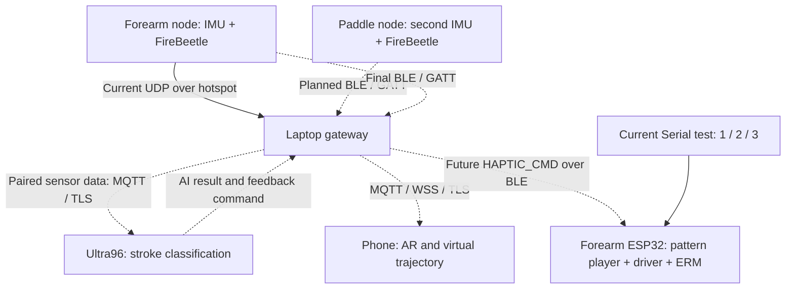
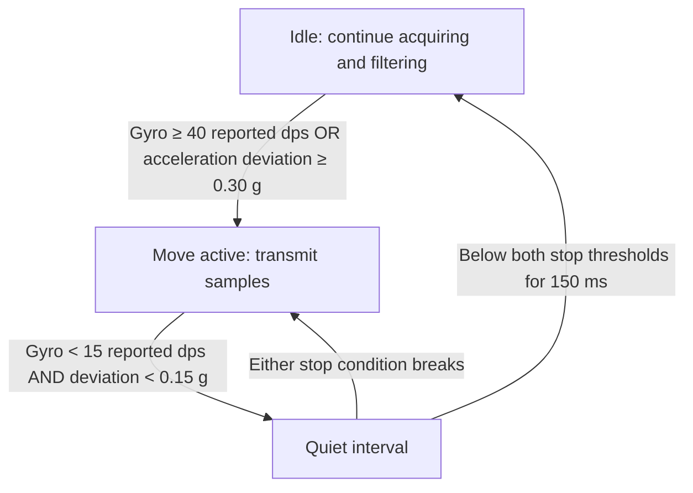
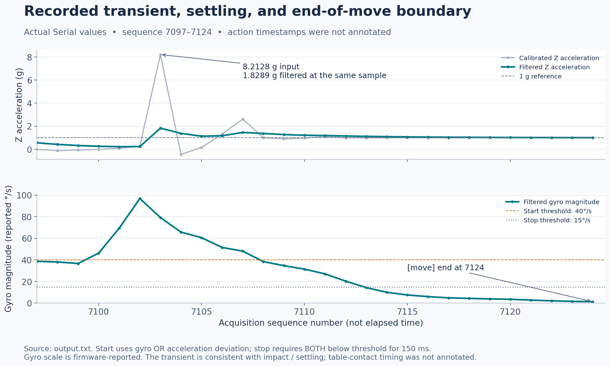
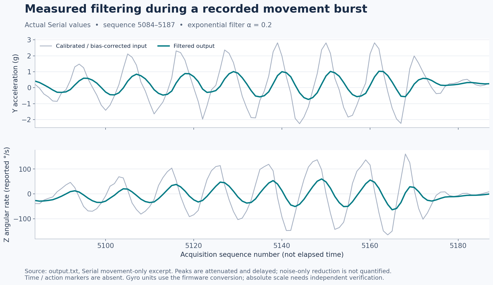
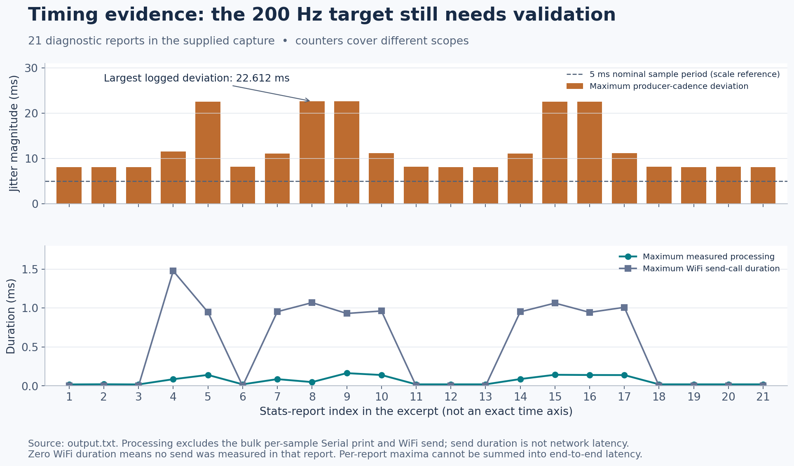

# PickleViz: Hardware Sensors

**Daniel Kwan · CG4002 · Group B17**  
**Implementation, algorithms and bench validation**

Presentation companion: `Hardware_Speaking_Script.md`  
Recording target: **9 minutes 20 seconds**, including screen changes. The required submission is one continuous **8–10 minute MP4**.

Use a Markdown preview with Mermaid support. Each numbered screen is a presentation stop, separated by a horizontal rule. Code excerpts are deliberately short. The evidence appendix after Screen 12 is for preparation and follow-up.

---

## Screen 01 · The problem and my hardware scope

**0:00–0:25**

Pickleball strokes happen too quickly for a player to judge every movement by feel alone. PickleViz aims to collect motion measurements, classify strokes and present useful feedback.

- Two intended sensing locations: dominant distal forearm and paddle handle.
- My hardware responsibility: acquire motion data, preprocess it, expose a usable interface and produce commanded tactile feedback.
- This checkpoint demonstrates the **forearm electronics and temporary laptop telemetry**.

**Evidence boundary:** stroke classification, AR feedback and the complete automatic feedback loop remain downstream integration work.

Source: design report §§1–3; `HARDWARE_PLAN.md`, scope and Phase G.

---

## Screen 02 · Overall architecture and feedback loop

**0:25–1:10 · Diagram A**



**Solid connections:** current bench paths. **Dashed connections:** intended final integration.

The intended loop is **motion sensing → preprocessing → AI decision → feedback command → forearm vibration**. Today, sensing/telemetry and the actuator command path have separate bench demonstrations. `MoveDetector` controls transmission and does not automatically trigger the motor.

Source: design report §§2–4; `HANDOFF.md`; current sketch.

---

## Screen 03 · Physical implementation, interfaces and power

**1:10–2:10 · Photo cue A: open the hardware-photo tab**

Point out the **FireBeetle, IMU breakout, breadboard power rails, haptic driver and ERM motor**. Show the actual battery connection if it is visible.

| Connection | Current implementation | Why it matters |
|---|---|---|
| FireBeetle GPIO21 / GPIO22 | IMU SDA / SCL over I²C | Simple wiring for one IMU per node |
| IMU VDD / GND | 3.3 V / shared ground | Common supply reference |
| IMU address | `0x68`, AD0 low | Driver targets the verified address |
| GPIO25 | Three-pin ERM module `IN` | GPIO controls the driver input |
| Haptic module VCC / GND | 3.3 V / shared ground | Driver supplies motor current |
| Battery path | Single-cell 3.7 V LiPo through FireBeetle JST | Intended standalone operation |

The installed haptic part is a **simple three-pin driver**, replacing the proposed DRV2605L. The motor does not connect directly to an ESP32 GPIO.

**Power and mechanical precautions:** verify JST polarity, use the intended protected cell, insulate exposed conductors and keep the battery away from sharp or crushing surfaces. Breadboard wiring supports rework at this stage.

**Pending evidence:** actual battery capacity/protection, power source used for `output.txt`, and a documented USB-disconnected run. The report's 500 mAh and roughly 85 mA forearm figures are design estimates.

Source: hardware plan, Decisions and Phases C/E/G; design report §3.5.

---

## Screen 04 · Acquisition and a defined data interface

**2:10–2:50 · Code snippets 1 and 2**

**Snippet 1 — current sketch configuration**

```cpp
const unsigned long SAMPLE_PERIOD_US = 5000;  // 200 Hz target
const int BUFFER_SIZE = 256;
const uint8_t NODE_ID = 1;
const AxisMapping& NODE_AXIS_MAPPING = AXIS_MAPPING_IDENTITY;
const bool ENABLE_WIFI_TELEMETRY = true;
const bool WIFI_ONLY_DEMO = false;
```

**Snippet 2 — corrected register burst, `ICM42686P.cpp`**

```cpp
uint8_t data[12];
if (!readRegisters(REG_ACCEL_DATA_X1, data, sizeof(data))) {
  return false;
}
// Accelerometer: data[0..5]. Gyroscope: data[6..11].
frame.gx = (int16_t)((data[6] << 8) | data[7]);
frame.gy = (int16_t)((data[8] << 8) | data[9]);
frame.gz = (int16_t)((data[10] << 8) | data[11]);
```

| `SensorFrame` group | Purpose |
|---|---|
| Node ID, sequence, `timestamp_us` | Identify and order samples; timestamp is relative to node boot |
| Raw counts | Preserve sensor readings for diagnosis |
| Physical-unit and filtered fields | Support downstream processing |
| Status bitfield | Report processing, saturation and movement flags |

The driver requests 200 Hz ODR. The main loop reads on a software schedule. This implementation does not use the IMU FIFO or a data-ready interrupt.

**Range/scale follow-up P1:** acceleration uses 2048 counts/g. The gyro configuration and conversion factor need alignment before claiming absolute angular-rate accuracy. Existing gyro plots retain the **firmware-reported scale**.

Source: `SensorFrame.h`, `ICM42686P.cpp`, sketch; see P1 for the datasheet comparison.

---

## Screen 05 · Calibration, filtering and data quality

**2:50–3:45 · Code snippets 3 and 4**

The startup procedure assumes a stationary sensor, with canonical **+Z upward** for accelerometer calibration. It takes **400 samples for each calibration**, with 5 ms delays plus read overhead.

**Snippet 3 — calibration calculations, abridged from `Calibration.cpp`**

```cpp
calibration.biasX = (float)sumX / calibrationSamples;
// Equivalent gyro calculations for Y and Z.

calibration.offsetX_g = sumX / calibrationSamples;
calibration.offsetY_g = sumY / calibrationSamples;
calibration.offsetZ_g = (sumZ / calibrationSamples) - 1.0;
```

Gyro correction subtracts the stationary mean. Accelerometer correction preserves the expected **1 g gravity component** in the calibration pose. This is a single-pose offset calibration, not a full scale/alignment calibration.

**Snippet 4 — first-order IIR filter, `LowPassFilter.cpp`**

```cpp
value = alpha * input + (1.0 - alpha) * value;
```

The sketch uses **α = 0.2 on all six channels**. Each channel stores only its previous output. Initialization uses the first input directly.

| Design choice | Benefit | Trade-off |
|---|---|---|
| Stationary mean calibration | Simple startup offset estimate | Movement during calibration biases the result |
| First-order IIR | Low memory and computation cost | Smoothing delays changes and attenuates brief peaks |
| Provisional identity axis mapping | One explicit mapping location | Mounting orientation still needs verification |
| Raw-count saturation check | Flags any axis with magnitude ≥29,490 counts, about 90% of range | Positive trigger path still needs a controlled test |

**Field distinction:** `ax_g`/`ay_g`/`az_g` are offset-corrected. `gx_dps`/`gy_dps`/`gz_dps` retain gyro bias. The filtered gyro fields include bias correction.

---

## Screen 06 · Movement gating and node control

**3:45–4:35 · Diagram B and code snippets 5–6**



Acceleration deviation is **|magnitude of filtered acceleration − 1 g|**. Gyro input is the magnitude of the filtered gyro vector.

**Snippet 5 — start and stop logic, `MoveDetector.cpp`**

```cpp
bool aboveStartThreshold =
    gyroMagDps >= GYRO_START_THRESHOLD_DPS ||
    accelDeviationG >= ACCEL_START_THRESHOLD_G;
bool belowStopThresholdNow =
    gyroMagDps < GYRO_STOP_THRESHOLD_DPS &&
    accelDeviationG < ACCEL_STOP_THRESHOLD_G;
```

**Snippet 6 — boundary frames, current sketch**

```cpp
bool shouldSendFrame = wasMoveActive || isMoveActiveNow;
if (shouldSendFrame) {
  frame.status_flags |= SENSOR_STATUS_MOVE_ACTIVE;
}
```

Different start/stop thresholds provide **hysteresis**. The quiet timer reduces rapid switching near a threshold. Thresholds are provisional and require retuning after the gyro scale check.

The lifecycle separately tracks **BOOT, CALIBRATING, STREAMING and FAULT**. `STREAMING` means the pipeline is running, even when the movement gate suppresses transmission. An IMU read failure latches a fault.

Source: `MoveDetector.h/.cpp`, `SensorFrame.h`, sketch.

---

## Screen 07 · Actuator control without blocking delays

**4:35–5:15 · Code snippet 7 · Photo cue B: motor and driver**

**Snippet 7 — double-pulse definition, current sketch**

```cpp
const HapticStep HAPTIC_STEPS_DOUBLE_PULSE[] = {
  { HAPTIC_DUTY_ON, 150 },
  { 0, 250 },
  { HAPTIC_DUTY_ON, 150 },
};
```

| Serial test key | Pattern | Commanded timing |
|---|---|---|
| `1` | Single | 150 ms on |
| `2` | Double | 150 ms on, 250 ms off, 150 ms on |
| `3` | Fault | Three 150 ms pulses, 100 ms gaps |

`triggerHapticPattern()` starts the pattern. `updateHapticPattern()` checks elapsed milliseconds in each loop and advances the steps. It contains no blocking `delay()`.

- Full duty is **255/255**. Bench notes report weak or imperceptible output below about 200/255.
- Phase E records that the user could distinguish all three patterns on the bench.
- Future Comms code will translate `HAPTIC_CMD` into this function call.
- Main-loop delays can still extend step durations. Exact waveform timing and comfort on the mounted forearm remain separate checks.

**Demo slot P5:** show keys `1`, `2`, `3` and the physical response if practical. A photo documents wiring, while a live demonstration or observation documents actuation.

---

## Screen 08 · Movement test and measured sensor response

**5:15–6:15 · Plots 1 and 2**

**User-reported procedure:** sensor stable on the table; lift; shake in the air; hold still in the air; return/drop onto the table.

The capture contains no synchronized labels for those physical actions. The plots identify **firmware movement bursts**, without assigning a specific action to an unannotated sample.

### Plot 1 · Transient and settling, sequences 7097–7124



### Plot 2 · Input and filtered response, sequences 5084–5187



**What the evidence supports**

- Multiple sensor channels change during the recorded movement bursts.
- The filtered traces smooth rapid sample-to-sample variation.
- At sequence 7103, calibrated Z is **8.2128 g**, while filtered Z is **1.8289 g** at that same sample. Later values settle near the gravity baseline. The filter substantially attenuates this transient.
- Gyro Z varies in the current capture, unlike the earlier constant-zero register-offset fault recorded in the plan.
- The firmware starts and ends transmission around its threshold-based movement decisions.

**Interpretation limits:** the x-axis is sample sequence, not measured elapsed time. Idle sensor samples are absent because the sketch only prints movement frames. Gyro values use the existing firmware conversion. These plots do not establish absolute orientation, calibrated angular-rate accuracy or impact-fidelity performance.

Source: `output.txt`; plotting method in Appendix B.

---

## Screen 09 · Matching the device and laptop evidence

**6:15–7:15 · Log excerpts 1–2**

**Log excerpt 1 — sequence 6560, compared at four decimal places**

| Channel group | Serial filtered fields | Python receiver |
|---|---|---|
| Acceleration, g | `(0.4534, -0.0959, 0.8640)` | `(0.4534, -0.0959, 0.8640)` |
| Gyro, reported dps | `(5.3491, -4.6819, 40.5718)` | `(5.3491, -4.6819, 40.5718)` |
| Status | `14` | `14` |

All **11 overlapping sequences** match on all six filtered channels within the Serial output's rounding. This is direct evidence that those processed frames reach the laptop with matching displayed values. It does not prove delivery of every frame.

**Status 14 = `0x02` physical-unit flag + `0x04` processing/calibration flag + `0x08` movement flag.** The saturation bit is clear. These flags describe firmware state, not independent measurement accuracy.

**Log excerpt 2 — an intentional transmission gap**

```text
[move] end seq=6549
[move] start seq=6560
```

The receiver reports `GAP(expected=6550)` at sequence 6560. Here the device log explains that samples **6550–6559** fall between movement bursts. The receiver's 0.2-second idle heuristic can merge closely spaced bursts.

The earlier `GAP(expected=861)` at sequence 921 remains unresolved because the supplied Serial extract starts later. The Python console also throttles ordinary output, so jumps between printed lines alone are not a loss count.

Source: `output.txt` lines 30, 257–260; first unresolved warning at line 5; receiver implementation.

---

## Screen 10 · Processing and timing evidence

**7:15–8:05 · Plot 3 and log excerpt 3**



**Log excerpt 3 — selected fields from one statistics report**

```text
state=STREAMING dropped=0 highWaterMark=1/256
maxProducerJitterUs=22612
maxProcessingUs=49 avgProcessingUs=41
cpuMarginUs=4951 sequenceGaps=0
maxWifiSendUs=1069 avgWifiSendUs=943
```

| Observation in this capture | Defensible interpretation |
|---|---|
| Buffer drop counter stays at 0; high-water mark stays at 1/256 | No reported buffer overflow in the supplied statistics |
| Consumer sequence-gap counters stay at 0 | No reported sequence discontinuity at that internal stage |
| Worst reported processing time is 164 µs | Timed processing is small relative to a 5 ms target |
| Worst reported WiFi send call is 1,476 µs | Local send-call cost is measured separately |
| Worst producer interval deviation is 22,612 µs | Steady 200 Hz acquisition is not established by this run |

`cpuMarginUs` is **5000 − timed consumer processing**. It excludes the IMU acquisition, verbose sample printing and WiFi send. It is not the full-loop timing margin. A successful UDP send call is also not an end-to-end delivery or latency measurement.

**Next timing check P2:** reduce per-sample printing and record device timestamps plus producer interval statistics. The present sketch prints long lines at 115200 baud during movements, creating a strong pacing concern.

Source: `output.txt`, especially line 176; timer placement in the sketch.

---

## Screen 11 · Changes from the proposal and their trade-offs

**8:05–8:55**

| Proposal | Current implementation | Reason and trade-off |
|---|---|---|
| SPI acquisition, preferred data-ready interrupt and FIFO | I²C register reads on a software schedule | Simpler available wiring; timing and freshness need further validation |
| DRV2605L haptic driver | Available three-pin ERM driver on GPIO25 | Matches the part on hand; firmware supplies pattern timing |
| BLE/GATT sensor link | Temporary WiFi UDP CSV bridge | Makes bench data visible before Comms integration; delivery is unacknowledged |
| Packaged forearm and paddle nodes | Forearm breadboard checkpoint | Keeps wiring accessible for rework; wearability and second-node validation remain open |
| Continuous sensor transport in the report | Continuous processing, movement-gated transport | Reduces idle transmissions; requires explicit burst semantics and can miss early motion |

The gyro byte-offset repair is a **bug fix**, rather than a planned architectural trade-off. The old read included timestamp registers. The current 12-byte burst maps all six sensor axes.

The latest sources also expose a **gyro full-scale/conversion mismatch**. It is recorded as follow-up P1, rather than treating the logged dps as verified physical truth.

Source: design report §§3–4; hardware plan Decisions, Phases D/E/G; implementation.

---

## Screen 12 · Current checkpoint and next acceptance gate

**8:55–9:20**

**Demonstrated or recorded:** real forearm IMU pipeline, six-axis processing, movement gating, matching device/laptop values, buffer diagnostics and bench-distinguishable haptic patterns.

**Next acceptance work:** align the gyro scale, measure complete acquisition timing and transport delivery, confirm LiPo-only operation, then validate the second node.

`HARDWARE_PLAN.md` keeps **Phase G** ahead of soldering and final pod design. The later hand-off remains a shared sensor-data contract plus the forearm haptic interface.

**Closing message:** the implementation demonstrates useful subsystem behaviour and exposes specific, measurable engineering tasks for the next validation run.

---

# Preparation appendix · Complete after the main walkthrough

These items are deliberately outside the timed presentation. Keep the cautious wording above until a new capture supports stronger claims. Do not read the blank fields aloud.

## Appendix A · Follow-up evidence slots

### P1 · Gyro range and scale alignment

The supplied driver writes `DEFAULT_GYRO_FS = 0x00`, then converts using `16.4` counts/(°/s). TDK's ICM-42686-P datasheet maps field `000` to ±4000 °/s and **8.2** counts/(°/s), while `001` maps to ±2000 °/s and **16.4**. Assuming these sources produced the run, the displayed gyro rates are approximately half the physical rate. Raw counts remain usable.

This discrepancy affects physical gyro values and movement thresholds. The driver conversion and the consumer's filtered conversion must agree with the selected range. Do not silently rescale this historical capture or claim a fix has already been flashed.

- Intended range: **[TO CONFIRM]**
- `GYRO_CONFIG0` register readback: **[PASTE]**
- Range/conversion alignment applied and flashed: **[PENDING]**
- New stationary gyro means and repeat movement capture: **[PASTE]**
- Movement thresholds reviewed after scale alignment: **[PENDING]**

Reference: [TDK ICM-42686-P datasheet, DS-000348, §3.1 and GYRO_CONFIG0](https://invensense.tdk.com/wp-content/uploads/documentation/ds-000348__icm-42686-p-datasheet.pdf).

### P2 · Acquisition timing and transport delivery

- Full capture after reducing per-sample Serial output: **[ATTACH]**
- Produced samples over measured elapsed time: **[COUNT / DURATION / Hz]**
- Sample-interval distribution and worst lateness: **[RESULTS]**
- Movement/burst identifier or explicit start/end records: **[DECISION]**
- Sent/received counts within equivalent bursts: **[RESULTS]**
- Duplicates, reordering and missing packet counts: **[RESULTS]**
- Latency method with a defined clock relationship, or round-trip test: **[METHOD / RESULTS]**

The printed sequence number advances whenever the firmware produces a frame. Buffer counters cannot detect acquisition periods skipped before frame production. Device `micros()` and laptop time are not synchronized in this bridge, so subtracting them does not establish one-way latency.

### P3 · Battery-only operation and actual parts

- Power source during the supplied capture: **[USB / LiPo / OTHER]**
- Battery label and capacity: **[PHOTO / VALUE]**
- Protection and connector polarity confirmed: **[EVIDENCE]**
- USB fully disconnected, successful boot/calibration/telemetry: **[RESULT]**
- Standalone run duration; voltage before/after: **[VALUES]**
- Measured current with motor idle/active, if available: **[VALUES]**

Use a battery-only demonstration to substantiate standalone operation. A photograph of a connected battery alone does not establish which source powered the capture.

### P4 · Second node, calibration and orientation

- Paddle role/unique node ID: **[VALUE]**
- Second-node IMU, timing and battery validation: **[RESULTS]**
- Fresh stationary gyro-bias confirmation after fixes: **[RESULTS]**
- Repeatable physical axis mapping for both nodes: **[MAPPING / PHOTOS]**
- Controlled test of the saturation flag's positive path: **[RESULT]**

Prefer an injected test value for the software threshold path over an unnecessarily violent physical test. A synthetic flag test validates logic, not the IMU's physical clipping behaviour.

### P5 · Haptic evidence and mounting

- Clear photo of GPIO25, module `IN/VCC/GND`, motor: **[PHOTO TAB]**
- Single/double/triple response demonstrated during recording: **[YES / NO]**
- Forearm-mounted distinguishability and comfort: **[OBSERVATION]**
- Optional measured waveform: **[CAPTURE]**

The plan records successful loose bench testing. It does not establish comfort, timing precision or motion-sensor interference when worn.

## Appendix B · Evidence provenance and plotting method

- Primary capture: `evidence/output.txt`, copied unchanged from the supplied file.
- The extract contains **289 Serial sample rows in six complete movement bursts**, **21 statistics reports** and **18 printed Python sample rows**. These counts describe the supplied extract, not the total packets received during the test.
- Serial rows contain raw and processed values. Python rows display filtered values, normally with throttled console output.
- Plot x-axes use sample sequence or statistics-report index. No 200 Hz time axis is fabricated.
- Break lines at absent sequence ranges. Do not fill idle gaps or assign unrecorded physical-action timestamps.
- Plot gyro channels on their original reported scale, with a visible caveat.
- Compare common sequence numbers across the two logs at their printed precision.
- Source code snippets are excerpts from the supplied files. Comments and line breaks may be shortened for display.
- Source documents: `CG4002_Design_Report(1).md`, `HARDWARE_PLAN.md`, `HANDOFF.md`. Current code takes precedence when those documents describe older defaults or omit the movement bit.

## Appendix C · Recording checklist

- Open the Markdown preview, script, plot images and hardware-photo tab before recording.
- Verify Mermaid rendering. Use Diagram A and Diagram B as the named screen cues.
- Zoom code and log excerpts so the audience can read them. Crop out unrelated windows and hotspot credentials.
- Keep the script off the recorded screen where possible. Bracketed script directions are not spoken.
- Use photo and motor demonstration slots within the assigned section times.
- Rehearse once. Target 9:20 and finish before 10:00. Include all tab changes in the timing.
- Record the whole walkthrough as one continuous video and export to MP4.
