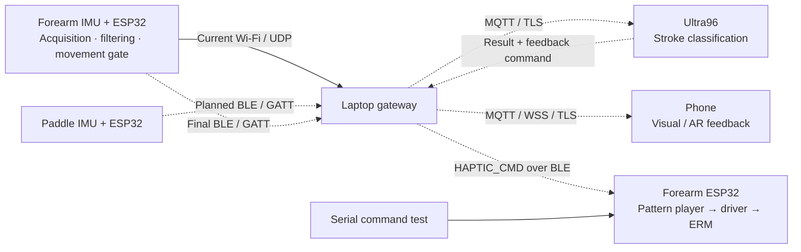
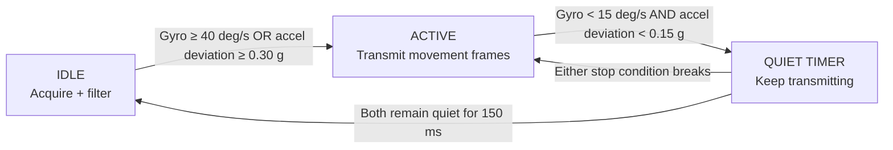
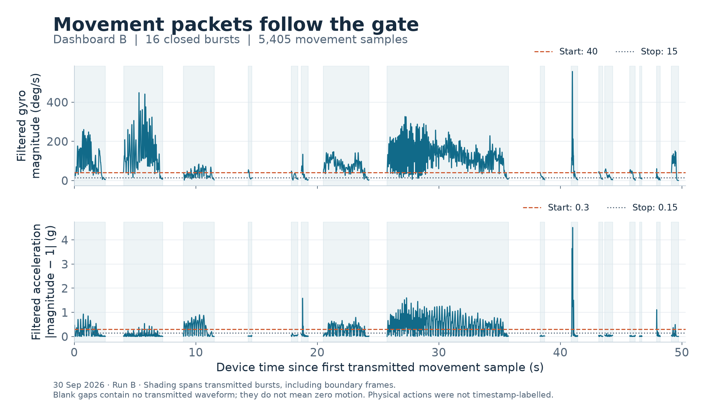
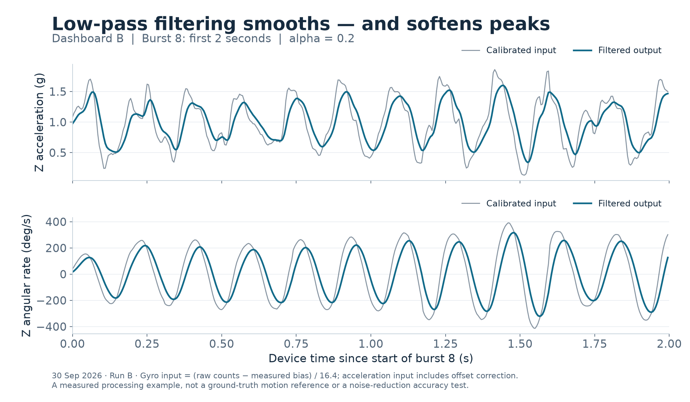
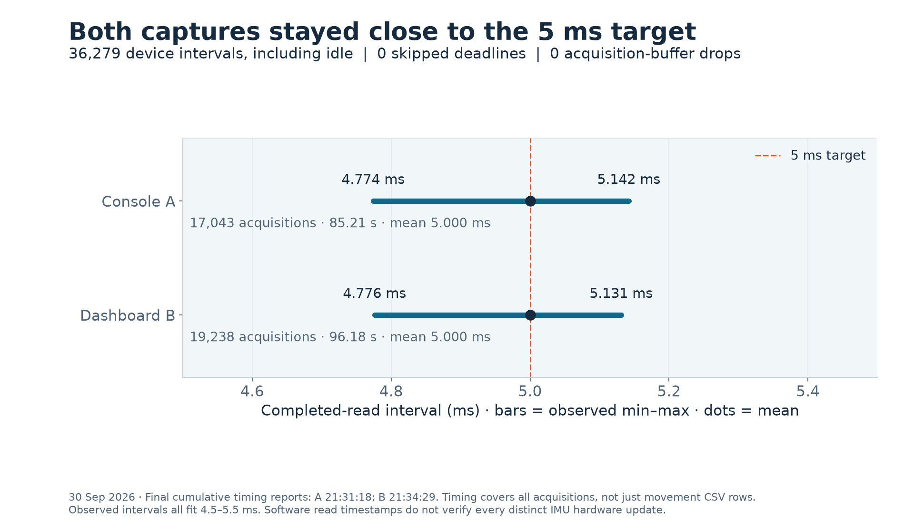

# PickleViz · Hardware Sensors

Daniel Kwan · CG4002 · Group B17

Motion sensing, on-device decisions and tactile feedback

---

## Screen 01 · Pickleball motion and feedback

Pickleball movements happen quickly. PickleViz aims to turn motion measurements into stroke analysis and feedback a player can use.

- **Sense:** capture forearm and paddle movement.
- **Decide:** preprocess measurements and support downstream stroke classification.
- **Respond:** present visual feedback and command forearm vibration.

This implementation validates the **forearm sensing pipeline and laptop telemetry**, with a separately bench-tested haptic output.

---

## Screen 02 · System architecture and feedback loop

### Diagram A · System architecture



**Solid:** implemented bench paths. **Dashed:** intended integration.

Sensor → preprocessing → AI decision → feedback command → actuator

The movement gate controls transmission; it does **not** classify strokes or trigger vibration automatically.

---

## Screen 03 · Digital sensing and battery-powered operation

| Hardware / interface | Implementation |
|---|---|
| Controller | FireBeetle 2 ESP32-E |
| Motion sensor | ICM-42686-P: three acceleration axes + three gyro axes |
| I²C | 400 kHz; SDA GPIO21, SCL GPIO22; address `0x68` |
| Sensor supply | 3.3 V and shared ground; no external ADC needed |
| Haptic output | GPIO25 PWM → three-pin driver → ERM motor |
| Driver supply | 3.3 V and shared ground; motor current is not drawn from GPIO |
| Standalone power | Single-cell LiPo through the FireBeetle battery connector |

**Evidence:** both final captures are documented as LiPo-powered with USB disconnected, as reported by the operator.

**Wearable precautions:** correct connector polarity, suitable cell/charging arrangement, insulated wiring and secure battery mounting. Capacity, protection details and endurance are not established by these captures.

---

## Screen 04 · Sensor configuration and sample records

### Snippet 1 · Shared acquisition and conversion settings

```cpp
// ImuConfig.h
constexpr uint8_t GYRO_CONFIG0 = 0x27;   // ±2000 deg/s, 200 Hz
constexpr uint8_t ACCEL_CONFIG0 = 0x27;  // ±16 g, 200 Hz
constexpr float GYRO_LSB_PER_DPS = 16.4f;
constexpr float ACCEL_LSB_PER_G = 2048.0f;
constexpr unsigned long SAMPLE_PERIOD_US = 5000;
```

**Both final captures:** `WHO_AM_I=0x44` · `GYRO_CONFIG0=0x27` · `ACCEL_CONFIG0=0x27` · `PWR_MGMT0=0x0F` · `verified=true`

The driver checks register readback before streaming. Configuration or read failure puts the node into a latched fault state.

### Snippet 2 · One checked 12-byte sensor read

```cpp
// ICM42686P.cpp — excerpt
uint8_t data[12];
if (!readRegisters(REG_ACCEL_DATA_X1, data, sizeof(data))) {
  return false;
}
// Acceleration: bytes 0–5. Angular rate: bytes 6–11.
frame.gx = (int16_t)((data[6] << 8) | data[7]);
```

Each frame retains **node ID, sequence, completed-read timestamp, raw counts, processed values and status**. A 256-frame acquisition buffer makes internal drops observable.

Readback verifies the range/conversion pairing, not absolute sensor accuracy. Mounted axis mapping remains to be validated.

---

## Screen 05 · Calibrate first, then smooth

**Startup condition:** sensor stationary, flat, +Z upward. Average 400 readings for gyro bias and another 400 for accelerometer offsets.

### Snippet 3 · Preserve gravity during offset calibration

```cpp
// Calibration.cpp
calibration.offsetX_g = sumX / calibrationSamples;
calibration.offsetY_g = sumY / calibrationSamples;
calibration.offsetZ_g = (sumZ / calibrationSamples) - 1.0;
```

Gyro bias is subtracted before filtering. Accelerometer offset correction leaves the expected **1 g at rest**; it is not gravity removal.

### Snippet 4 · First-order low-pass filter

```cpp
// LowPassFilter.cpp — expression; alpha = 0.2
value = alpha * input + (1.0 - alpha) * value;
```

- **Why:** constant memory and low computation across six channels.
- **Trade-off:** smoother traces, but delayed response and smaller short peaks.
- **Inspectability:** retain raw and processed values; flag near-range-limit samples.

---

## Screen 06 · Send movement, keep sampling at rest

### Diagram B · Movement gate with hysteresis



Inputs are **filtered gyro vector magnitude** and **absolute deviation of filtered acceleration magnitude from 1 g**.

### Snippet 5 · Different start and stop decisions

```cpp
// MoveDetector.cpp — excerpt
bool aboveStartThreshold =
    gyroMagDps >= GYRO_START_THRESHOLD_DPS || accelDeviationG >= ACCEL_START_THRESHOLD_G;
bool belowStopThresholdNow =
    gyroMagDps < GYRO_STOP_THRESHOLD_DPS && accelDeviationG < ACCEL_STOP_THRESHOLD_G;
```

### Snippet 6 · Keep both boundary frames

```cpp
// CG4002_hardware.ino
bool shouldSendFrame = wasMoveActive || isMoveActiveNow;
```

Lower stop thresholds and a quiet timer prevent rapid switching. Idle samples remain part of acquisition diagnostics, but are intentionally omitted from movement packets.

These are provisional movement thresholds, not validated stroke labels.

---

## Screen 07 · Tactile patterns without blocking waits

### Snippet 7 · A double pulse is a sequence of timed steps

```cpp
// CG4002_hardware.ino
const HapticStep HAPTIC_STEPS_DOUBLE_PULSE[] = {
  { HAPTIC_DUTY_ON, 150 },
  { 0, 250 },
  { HAPTIC_DUTY_ON, 150 },
};
```

| Pattern | Commanded timing |
|---|---|
| Single | 150 ms on |
| Double | 150 ms on → 250 ms off → 150 ms on |
| Fault indication | Three 150 ms pulses with 100 ms gaps |

`triggerHapticPattern()` starts a pattern. `updateHapticPattern()` checks elapsed time and advances it during normal loop execution, without `delay()`.

**Recorded bench observation:** the three patterns were distinguishable at full duty, 255/255, using Serial commands. A future communications handler can use the same trigger function.

Mounted comfort, exact pulse timing and simultaneous motor/sensor interference remain separate checks.

---

## Screen 08 · Measured movement and filter behaviour

**Test activities:** stationary holds, lifting, shaking and returning the sensor to rest. Final captures compare console and dashboard receivers under operator-reported LiPo power, USB disconnected.

### Plot 1 · Movement packets across a captured session



Sixteen closed bursts in the dashboard capture. Blank gaps are deliberately unplotted: no full idle waveform was transmitted. Physical actions were not timestamp-labelled.

### Plot 2 · Calibrated input versus filtered output



The filter reduces rapid variation and softens peaks. These are measured channel responses, not a reference measurement of stroke accuracy or impact fidelity.

---

## Screen 09 · Account for every transmitted burst

### Snippet 8 · Bound the queue and batch the network work

```cpp
// TxQueue.h — selected constants
static constexpr size_t CAPACITY = 128;
static constexpr size_t BATCH_SIZE = 5;
static constexpr uint32_t FLUSH_MS = 20;
static constexpr uint32_t MAX_AGE_MS = 1000;
static constexpr uint32_t RETRY_MS = 10;
```

Up to five complete sample rows share a datagram, retaining their original IDs and acquisition timestamps. At full batches, **200 samples/s ≈ 40 data datagrams/s**, plus diagnostics.

- **Transient local send error:** keep the exact batch; retry later without a blocking wait.
- **Bounded memory and age:** count overflow, expiry and final drops explicitly.
- **Unambiguous closure:** finalize a burst only after the gate closes and its pending count reaches zero.
- **Receiver check:** compare unique samples by boot, burst and within-burst index; do not count intentional idle gaps as lost movement.

### Final capture results · 30 September 2026

| Closed-burst evidence | Console A | Dashboard B |
|---|---:|---:|
| Closed, finalized bursts | 12 | 16 |
| Movement samples offered | 5,588 | 5,405 |
| Accepted by local UDP send | 5,588 | 5,405 |
| Unique samples received | 5,588 | 5,405 |
| Accepted but not received | 0 | 0 |
| Local socket errors / final sample drops | 0 / 0 | 0 / 0 |

**10,993 / 10,993 movement samples received.** Neither capture required a retry. No pending, partial or unseen bursts remain in these totals.

UDP acceptance alone is not delivery proof. These completed captures show full receipt; they do not guarantee lossless delivery under every network condition.

---

## Screen 10 · Protect the 5 ms acquisition cadence

### Snippet 9 · Admit network work only in a suitable time slot

```cpp
// CG4002_hardware.ino — start of serviceTelemetry()
if (!ENABLE_WIFI_TELEMETRY || !telemetryScheduler.takeSlot(micros(),
    nextSampleTime, nextSeq, nodeState != NODE_FAULT)) return;
```

At most one potentially expensive network operation per completed acquisition, admitted only with **more than 3.5 ms remaining**. Diagnostic parts are staggered by at least 10 ms; verbose per-sample Serial output is disabled for capture.

### Plot 3 · Timing includes movement and idle acquisitions



| Acquisition evidence | Console A | Dashboard B |
|---|---:|---:|
| Completed acquisitions | 17,043 | 19,238 |
| Measured acquisition span | 85.21 s | 96.18 s |
| Mean acquisition rate | 200.00 Hz | 200.00 Hz |
| Observed interval range | 4.774–5.142 ms | 4.776–5.131 ms |
| Skipped deadlines / acquisition-buffer drops | 0 / 0 | 0 / 0 |
| Maximum diagnostic service time | 1.017 ms | 1.056 ms |

**All 36,279 recorded intervals fall within 4.5–5.5 ms.** These are device completed-read timestamps, not network arrival timing or proof of distinct hardware sensor updates. The scheduler is cooperative, not a hard real-time guarantee.

---

## Screen 11 · Implementation choices and trade-offs

| Proposal / requirement | Implemented choice and rationale | Trade-off |
|---|---|---|
| SPI with interrupt/FIFO acquisition | I²C with checked, timestamped 12-byte reads; simpler prototype wiring | Software cadence must be measured; no FIFO/DRDY validation |
| DRV2605L haptic driver | Available three-pin driver; firmware generates timed patterns | Simpler hardware, fewer driver-managed effects |
| BLE node links | Temporary Wi-Fi/UDP for inspectable laptop captures | Final BLE integration and its timing need separate validation |
| Continuous acquisition | Keep sampling; gate movement transmission and batch packets | Lower packet load, but no full idle waveform at the laptop |
| Wearable end product | Breadboard forearm electronics first | Accessible connections; mounting and second-node validation remain |

Calibration, filtering, hysteresis, bounded queues and staggered diagnostics make the current pipeline **measurable and inspectable**.

---

## Screen 12 · A validated forearm pipeline, ready for integration

- **Known sensor configuration:** register readback matches the range and conversion factors.
- **Measured acquisition:** about 200 Hz in both final LiPo captures, with no skipped deadlines or internal drops.
- **Verified movement delivery:** 10,993 unique samples received across 28 finalized bursts.
- **Commanded feedback:** three haptic patterns distinguished in separate bench testing.

Next: validate the paddle node and mounted axes, integrate BLE and the automatic feedback command, and evaluate mounted haptics and endurance.

